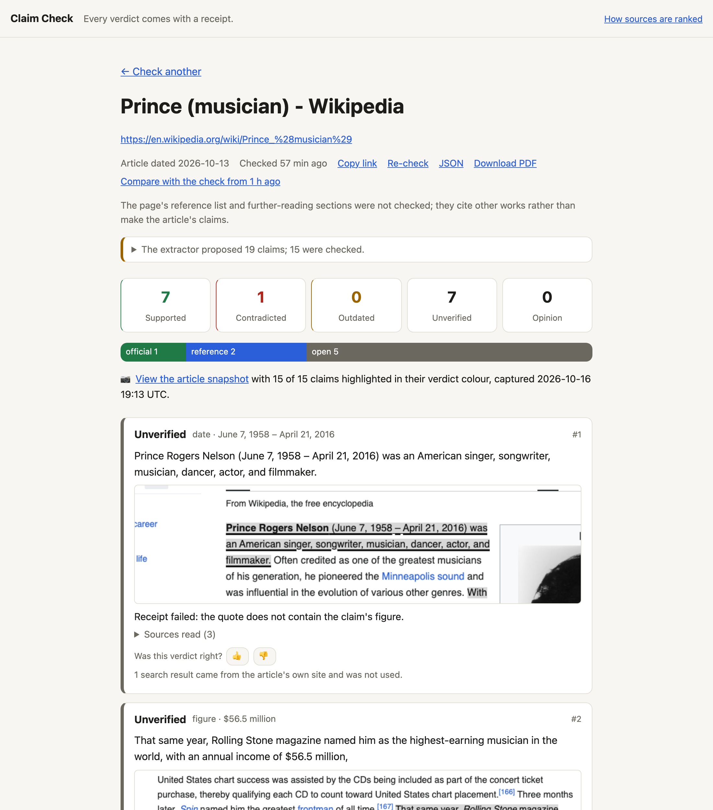
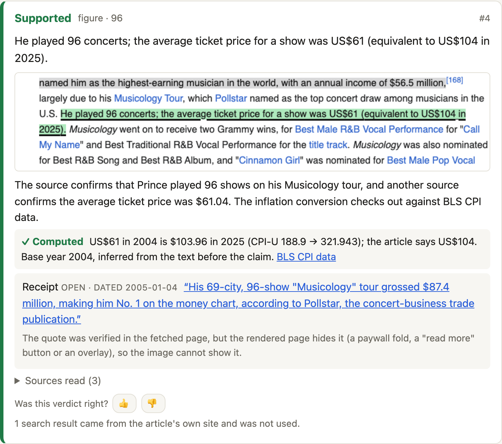
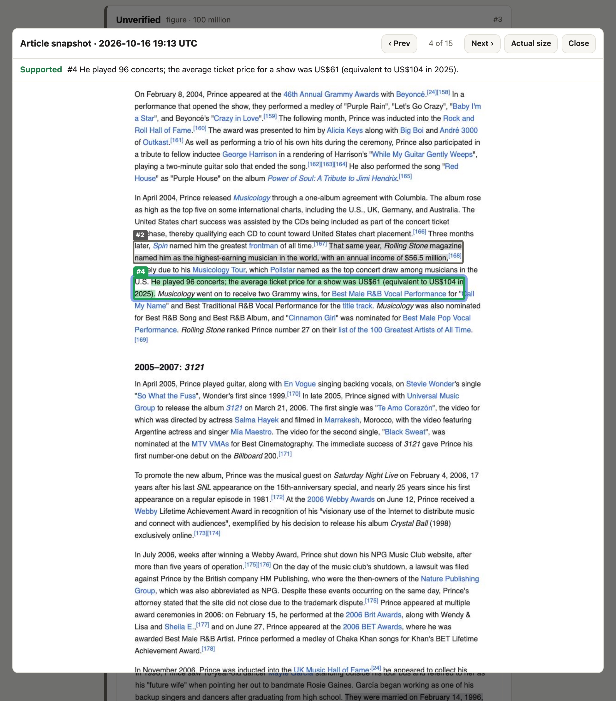

# Claim Check

**Paste an article URL. Every factual claim gets a verdict, and every verdict
comes with a receipt.**

Claim Check pulls the checkable claims out of any article, finds sources for
each one, and asks a model to judge them. Then code checks the model's work:
a verdict only counts if its quote really is on the source page. Each claim
ends up **supported**, **contradicted**, **outdated**, **unverified** or
**opinion**, and the report shows exactly where in the article it sits.

> A model that cannot produce a receipt gets "unverified", never "probably fine".

▶ **[Watch the 90-second demo](docs/claim-check-demo.mp4)**: a live check of a
Wikipedia article, from pasting the link to the highlighted snapshots.



## What makes it different

- **Receipts, held to the page.** A supported, contradicted or outdated
  verdict needs a quote (or up to three excerpts of one page) that code finds
  word for word on a page that was
  actually fetched. A figure claim needs its numbers and dates in the quote,
  compared by value and the way the claim states them: "exceeding 100
  million" is met by 104 million, "about 500" by 520, a plain "13 million" by
  13.4 million; a plain "100 million" is never met by 150 million. Pages that
  are lists of fragments (Wikidata, catalogues) are not used as sources. A failed check becomes "unverified" with the reason,
  and the refused quote is shown; it is never retried into a pass.
- **The article is never its own source.** Search results from the article's
  own site, or an archived copy of it, are thrown out.
- **Dates matter.** A source older than the claim cannot "contradict" it; it
  can only show an older figure.
- **Arithmetic is done by code.** An inflation conversion such as "US$61
  (equivalent to US$104 in 2025)" is computed from Bureau of Labor Statistics
  CPI data, not judged by the model.
- **It shows what it skipped.** Figures no claim covers, claims over the limit,
  text it could not read, paywalled sources, off-topic search results: all on
  the report.



## Features

- **Live report.** Claims fill in as they are checked, with a running clock.
  Reports are saved and shareable at `/r/<id>`.
- **Snapshots.** A headless browser captures the article with every claim
  painted in its verdict colour, and each source with its quote highlighted.
  A source page can change; the snapshot does not.
- **Snapshot viewer.** Click a claim's thumbnail to jump to it on the
  captured page, with numbered markers on every claim.
- **Citation audit.** What each claim's own cited links actually said.
  Wikipedia footnotes are followed to the cited source.
- **Source tiers.** Each receipt is labelled official, reference or open,
  decided by the site's address alone (government sites, universities,
  papers of record and so on). `/sources` explains the rules.
- **Compare.** See which verdicts changed since the last check of an article.
- **Suggested corrections.** A contradicted or outdated claim gets the
  sentence as its receipt would have it, kept only if every figure and word
  it adds is in the receipt. Shown as "what the source says", for a reader
  of any page; a publisher's tools can turn it into an edit.
- **Your own data, plugged in.** Records from your own database as sources
  (decisive if you say so), your own trusted and excluded sites. See
  [Plug-ins](#plug-ins).
- **Drafts.** Check an article before it has an address: send its HTML.
- **PDF export, share previews, a bookmarklet, and a JSON API** with signed
  callbacks and an optional access token.
- **Feedback.** Thumbs up or down on any verdict, exported at `/api/feedback`.



## Quick start

You need Python 3.12+, [uv](https://docs.astral.sh/uv/), and an
[OpenRouter](https://openrouter.ai/) API key.

```bash
git clone https://github.com/mpgray/claim-check.git
cd claim-check
uv sync
uv run playwright install chromium     # once, about 300 MB, for snapshots
cp .env.example .env                    # then put your OpenRouter key in it
uv run python -m scripts.check_backend  # checks the model and search work
uv run python -m app                    # http://127.0.0.1:8050
```

With no key at all, the app runs with an offline stand-in model that only
matches figures literally; useful for trying the UI and for the tests.

```bash
uv run python -m pytest -q
```

## Configuration

Everything is set in `.env` (the app reads it on every start, and editing it
restarts the dev server); `.env.example` lists every setting. The home page
shows the limits in effect.

| Variable | Default | What it does |
|---|---|---|
| `CC_OPENROUTER_API_KEY` | | Model and web search through OpenRouter |
| `CC_LLM_MODEL` | `google/gemma-4-31b-it` | The model that extracts and judges claims |
| `CC_SEARCH_MODEL` | the chat model | A model with web-plugin support, for search |
| `CC_MAX_CLAIMS` | 15 | Claims checked per article |
| `CC_MAX_SOURCES` | 3 | Sources read per claim |
| `CC_WORKERS` | 8 | Claims checked at once |
| `CC_SNAPSHOTS` | 1 | `0` turns snapshots off |
| `CC_OFFICIAL_DOMAINS`, `CC_REFERENCE_DOMAINS` | | Added to the built-in tiers |
| `CC_LLM_BASE_URL`, `CC_LLM_API_KEY` | | Any other OpenAI-compatible API |
| `CC_SEARXNG_URL` | | A self-hosted SearXNG for search |
| `CC_PLUGINS` | | Plug-ins to load, `module:attr,...` |
| `CC_ENTRY_PLUGINS` | `1` | `0` ignores installed `claim_check.plugins` entry points |
| `CC_API_TOKEN` | | Every route but `/healthz` needs it (bearer header or `/login`) |
| `CC_WEBHOOK_SECRET` | | Signs callbacks; without it callbacks are refused |
| `CC_CALLBACK_HOSTS` | | Non-public hosts a callback may reach |

Each report records how long each stage took and shows the total in its
header. A typical 15,000-character article with 25 claims takes about 70
seconds.

## How it works

```
fetch the article ─► readable body, its date, its cited links
      │
model: list the claims, section by section, twice; name the subject
      │
code:  keep a claim only if its text is word for word in the article
      │
search, naming the subject ─► fetch sources (HTML or PDF)
      │  the claim's own citations first, then official and reference sites
      │  drop the article's own site and pages that never mention the subject
      │
code:  compute inflation conversions from BLS CPI data
model: judge each claim against its sources
      │
code:  is the quote on the page? the figure in the quote? the source
      │  newer than the claim? a date for "outdated"? otherwise unverified
      │
snapshot: render the article and each source, highlight, save
      │
report: saved, streamed live, shareable
```

| Step | Code |
|---|---|
| Fetching, readable text, PDF | `app/fetch.py`, `app/dates.py` |
| Claim extraction and validation | `app/prompts.py`, `app/claims.py` |
| Search and source tiers | `app/search.py` |
| The pipeline | `app/pipeline.py` |
| The receipt check | `app/verify.py` |
| Inflation | `app/inflation.py` |
| Snapshots | `app/snapshot.py`, `app/static/highlight.js` |
| Reports and live progress | `app/store.py`, `app/jobs.py`, `app/templates/` |

## API

```bash
# A published article, or a draft (html or text) that has no address yet
curl -X POST localhost:8050/api/checks -H 'Content-Type: application/json' -d '{
  "html": "<article>...</article>", "site": "myblog.example", "title": "Draft",
  "context": {"official_domains": ["agency.gov"], "exclude_domains": ["mysisterblog.example"]},
  "callback_url": "https://myblog.example/hooks/claim-check"
}'
# -> 202 {"id": "...", "api": ".../api/r/<id>", "report": ".../r/<id>", "schema_version": 1}
```

- `site` is the publisher: never a source, like the article's own site.
- `context` applies to this check only: `official_domains` and
  `reference_domains` add to the tiers, `exclude_domains` are never used as
  sources (your other sites), and `plugin` is passed through to plug-ins.
- `callback_url` receives the report JSON when the check ends, signed:
  `X-Claim-Check-Signature: v1=<HMAC-SHA256(CC_WEBHOOK_SECRET, "<timestamp>\n<body>")>`
  with `X-Claim-Check-Timestamp`. `app.callback.verify` checks one. Without
  a callback, poll `GET /api/r/<id>` until `status` is `done` or `error`.
- `GET /r/<id>?embed=1` is the report without the site's header, for an
  iframe in your own tools.
- Report JSON carries `schema_version`; it goes up when a field changes
  meaning or goes away.

## Plug-ins

A plug-in adds what only you have, without forking. It is any Python object
with some of these methods (`app/plugins.py` documents each):

| Method | What it adds |
|---|---|
| `documents(claim, report)` | Records from your own data, as sources. A `decisive` record is judged first and alone; when it settles the claim, no web page overrules it |
| `leads(claim, report)` | URLs to read before search results |
| `tier(url)` | Your tier for a site; the best tier any rule gives wins |
| `excluded(url)` | Sites never to use (your other sites, content farms) |
| `init_app(app)` | Routes or authentication of your own |

Install it as a `claim_check.plugins` entry point, or name it in
`CC_PLUGINS=module:attr`. `examples/records_csv/` turns a CSV file into
decisive records. Records do not loosen the receipt rule: the model must
quote a record word for word, a figure must be in the quote, and every
receipt says it came from a record. A report lists the plug-ins that took
part, and any that failed.

## Limitations

- **Run it locally or behind your own access control.** `CC_API_TOKEN`
  locks every route, and the fetcher refuses private and internal addresses,
  but DNS rebinding is not yet closed and there is no rate limiting.
- **Model output varies.** Different runs, or different OpenRouter providers,
  can pick somewhat different claims.
- **Some sites block headless browsers** (Cloudflare) or hide text behind a
  paywall. Their snapshots say so instead of showing a misleading image.
- **"Unverified" is not "false".** It means no source that was read settled
  the claim. A contradiction needs a source that says otherwise.

## License

[MIT](LICENSE)
